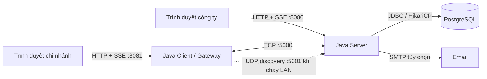

# Hệ thống phân phối hàng hóa với cảnh báo thiếu hàng tự động

Ứng dụng Client/Server cho bài tập lớn môn **Lập trình mạng — Chủ đề 3**, mô phỏng công ty có kho tổng và nhiều chi nhánh. Hệ thống ghi nhận bán hàng, tự cảnh báo khi tồn kho dưới ngưỡng, điều phối cấp hàng và theo dõi công nợ.

Nghiệp vụ trao đổi qua **TCP bằng giao thức tự thiết kế**. Java xử lý kết nối, đồng thời, heartbeat và tự nối lại; giao diện web nhận cập nhật qua Server-Sent Events (SSE). Kho mã còn có bộ giả lập tải và các thực nghiệm so sánh xử lý mạng, tranh chấp kho và độ tin cậy của tin nhắn.

## Mục lục

- [Chức năng chính](#chức-năng-chính)
- [Kiến trúc và công nghệ](#kiến-trúc-và-công-nghệ)
- [Chạy nhanh bằng Docker](#chạy-nhanh-bằng-docker)
- [Chạy trực tiếp trên Windows](#chạy-trực-tiếp-trên-windows)
- [Kịch bản demo](#kịch-bản-demo)
- [Cấu hình](#cấu-hình)
- [Triển khai qua Tailscale](#triển-khai-qua-tailscale)
- [Giao thức và tính nhất quán dữ liệu](#giao-thức-và-tính-nhất-quán-dữ-liệu)
- [Kiểm thử và thực nghiệm](#kiểm-thử-và-thực-nghiệm)
- [Cấu trúc thư mục](#cấu-trúc-thư-mục)
- [Xử lý lỗi thường gặp](#xử-lý-lỗi-thường-gặp)
- [Giới hạn hiện tại](#giới-hạn-hiện-tại)
- [Tài liệu chi tiết](#tài-liệu-chi-tiết)

## Chức năng chính

| Công ty | Chi nhánh |
|---|---|
| Quản lý sản phẩm, danh mục, nhà cung cấp và nhập kho tổng | Xem tồn kho, ghi nhận bán hàng, đặt ngưỡng tối thiểu |
| Nhận cảnh báo thiếu hàng; gửi hàng, đề xuất cấp hàng hoặc báo thiếu | Tự gửi cảnh báo thiếu hàng; chấp nhận hoặc từ chối đề xuất |
| Điều phối hàng giữa các chi nhánh và bổ sung hàng chủ động | Phản hồi điều chuyển, xác nhận số lượng thực nhận |
| Theo dõi kho, phiếu xuất, chênh lệch giao nhận và công nợ | Xem lịch sử nhận hàng và công nợ |
| Gửi thông báo thường, hỏi nhu cầu hoặc giới thiệu sản phẩm mới | Trả lời thông báo và yêu cầu nhập hàng kèm số lượng |
| Giám sát TCP, heartbeat trình duyệt, nhật ký và sự kiện bảo mật | Tự nối lại, đăng nhập lại và đồng bộ trạng thái khi kết nối phục hồi |

Email bổ sung cho thông báo công ty, cảnh báo bảo mật và khôi phục mật khẩu. Muốn sử dụng cần cấu hình SMTP và địa chỉ nhận trong cơ sở dữ liệu.

## Kiến trúc và công nghệ



Chỉ server truy cập database. Mỗi agent chi nhánh giữ một kết nối TCP với server; gateway Docker có thể phục vụ nhiều chi nhánh, mỗi chi nhánh có agent riêng. Next.js xuất giao diện tĩnh vào `ui/out/` để tiến trình Java phục vụ.

| Thành phần | Công nghệ |
|---|---|
| Server và client | Java 17; NIO `Selector` mặc định, BIO để đối chiếu; UDP discovery |
| Dữ liệu | PostgreSQL, JDBC, HikariCP; transaction và khóa dòng |
| Giao diện nghiệp vụ | Next.js 15.5, React 19.1, TypeScript 5.9 |
| Trang giới thiệu | React, TypeScript, Vite trong `landing/`; build riêng |
| Build và đóng gói | Maven đa module, npm, Docker Compose |
| Kiểm thử và đo tải | JUnit 5, `loadsim`, thực nghiệm E1–E9, kết quả CSV/Markdown |

## Chạy nhanh bằng Docker

Cần **Docker Desktop** đang chạy trên Windows, hoặc Docker Engine có Compose v2. Docker tự build giao diện, đóng gói Java và khởi tạo PostgreSQL; không cần cài riêng JDK, Maven hay Node.js trên máy host.

Các lệnh PowerShell dưới đây chạy tại thư mục gốc kho mã.

1. Nếu chưa có `.env`, tạo từ mẫu:

   ```powershell
   Copy-Item .env.example .env
   ```

   Chỉnh mật khẩu, cổng và SMTP nếu cần. Giữ cấu hình riêng nếu máy đã có `.env`.

2. Khởi động database, chạy migration và build ứng dụng:

   ```powershell
   .\scripts\docker-deploy.bat
   ```

3. Mở giao diện bằng các địa chỉ mặc định:

   | Dịch vụ | Địa chỉ | Tài khoản mẫu |
   |---|---|---|
   | Công ty | http://127.0.0.1:8080/admin/ | `admin` / `admin123` |
   | Chi nhánh | http://127.0.0.1:8081/branch/ | `CN01`, `CN02` hoặc `CN03` / `123456` |
   | PostgreSQL | `127.0.0.1:5433`, database `phan_phoi_hang` | `postgres` / giá trị `DB_PASSWORD` |

   Tài khoản trên áp dụng với dữ liệu mới và mật khẩu mặc định chưa được đổi. Sau khi chi nhánh đăng nhập, URL chuyển sang đường dẫn theo tên chi nhánh. Một gateway dùng chung cho các chi nhánh; không cần thêm container cho từng tài khoản.

Database lưu trong volume `pgdata`. Script khởi tạo chỉ nạp dữ liệu khi volume còn trống; `SEED_DEMO=1` mặc định thêm lịch sử giao dịch và dữ liệu demo. Đổi biến seed hoặc mật khẩu PostgreSQL trong `.env` không tự cập nhật database đã tồn tại.

```powershell
# Kiểm tra trạng thái, xem log và dừng dịch vụ
# Chạy từng lệnh khi cần; lệnh xem log chạy liên tục tới khi nhấn Ctrl+C.
docker compose ps
docker compose logs -f --tail=100 server client
.\scripts\docker-stop.bat
```

Để cập nhật sau khi sửa mã nguồn, chạy lại `.\scripts\docker-deploy.bat`. Script giữ dữ liệu hiện có; `docker compose down -v` sẽ xóa volume database.

## Chạy trực tiếp trên Windows

Cần **JDK 17**, **Maven 3.9**, **Node.js 22** và **PostgreSQL 14 trở lên**. Các lệnh `java`, `mvn`, `npm` cần có trong `PATH`; script cũng hỗ trợ JDK/Maven portable trong `tools/` nếu có.

### 1. Tạo database và cấu hình kết nối

Với PostgreSQL 18 cài ở đường dẫn mặc định:

```powershell
.\scripts\setup-db.bat
Copy-Item .\config\server.local.properties.example .\config\server.local.properties
```

Nếu dùng đường dẫn khác, truyền `psql.exe` tương ứng, ví dụ:

```powershell
.\scripts\setup-db.bat "C:\Program Files\PostgreSQL\17\bin\psql.exe"
```

Script dành cho database mới: tạo `phan_phoi_hang`, nạp schema, sản phẩm, ảnh và tài khoản mẫu, bao gồm `SIM001`–`SIM1000` cho giả lập tải. Trong `config/server.local.properties`, điền `db.password`; sửa thêm `db.url`, `db.user` nếu PostgreSQL không dùng địa chỉ và tài khoản mặc định. Nếu đã có file cấu hình local, chỉnh file hiện có thay vì copy đè.

Áp dụng migration bổ sung bằng `psql.exe` tương ứng với bản cài trên máy:

```powershell
$psqlExe = "C:\Program Files\PostgreSQL\18\bin\psql.exe"
& $psqlExe -h 127.0.0.1 -U postgres -d phan_phoi_hang -v ON_ERROR_STOP=1 -f db/migrate_branch_emails.sql -f db/migrate_anti_scraping.sql -f db/migrate_password_recovery.sql -f db/migrate_received_quantity.sql
```

Với database từ bản trước, sao lưu trước khi chọn migration phù hợp. `scripts/migrate-db.bat` chuyển dữ liệu mẫu cũ sang Toboki và `scripts/seed-demo.bat` nạp lại demo **có xóa dữ liệu nghiệp vụ**; chỉ dùng khi chủ động muốn đặt lại dữ liệu thử nghiệm.

### 2. Build và chạy

```powershell
.\scripts\build.bat
```

Script build giao diện vào `ui/out/`, chạy kiểm thử Maven và tạo `server/target/server.jar`, `client/target/client.jar`, `loadsim/target/loadsim.jar`.

Mở terminal riêng cho từng tiến trình:

```powershell
# Terminal 1: công ty
.\scripts\run-server.bat
```

```powershell
# Terminal 2: chi nhánh, kết nối rõ địa chỉ server
.\scripts\run-client.bat server=127.0.0.1:5000
```

```powershell
# Terminal 3, nếu muốn thêm client trên cùng máy
.\scripts\run-client.bat server=127.0.0.1:5000 http.port=8082
```

Giao diện mặc định là `http://127.0.0.1:8080/admin/` và `http://127.0.0.1:8081/branch/`. Bỏ tham số `server=...` để dùng UDP discovery trong LAN. Khi broadcast bị chặn, đặt IP máy công ty qua cấu hình hoặc tham số dòng lệnh; cổng TCP phải truy cập được từ máy chi nhánh.

### 3. Phát triển giao diện

Giữ các tiến trình Java đang chạy, sau đó chạy lệnh tương ứng trong `ui/`:

```powershell
Set-Location ui
npm ci
npm run dev:admin
# Hoặc chạy trong terminal khác: npm run dev:branch
```

Trang admin dùng cổng `3000`, trang chi nhánh dùng `3001`; API được chuyển tiếp tới Java ở `8080` và `8081`. Khi chạy bản đã build, Java phục vụ file tĩnh và không cần tiến trình Node.js.

## Kịch bản demo

1. Đăng nhập trang công ty bằng `admin` và trang chi nhánh bằng `CN01`.
2. Tại chi nhánh, chọn sản phẩm còn hàng, đặt ngưỡng và ghi nhận bán để tồn kho xuống dưới ngưỡng.
3. Tại công ty, mở cảnh báo mới rồi **Gửi hàng**, hoặc gửi đề xuất để chi nhánh xác nhận.
4. Tại chi nhánh, xác nhận **số lượng thực nhận**. Kiểm tra tồn kho, trạng thái yêu cầu, chênh lệch giao nhận và công nợ ở cả hai phía.
5. Thử gửi thông báo hỏi nhu cầu hoặc giới thiệu sản phẩm mới; trả lời từ chi nhánh để tạo yêu cầu cấp hàng.
6. Mở **Giám sát** để xem kết nối, nhật ký thao tác và sự kiện bảo mật.

Dữ liệu máy móc mô phỏng theo danh mục Toboki. Nhà cung cấp, chính sách giá, công nợ và giao dịch mẫu phục vụ học tập; nguồn và giấy phép ảnh nằm trong [scripts/images/credits.json](scripts/images/credits.json).

## Cấu hình

Khi chạy Java trực tiếp, thứ tự ghi đè là **file `.properties` → file `.local.properties` cùng tên → tham số `key=value`**. Ví dụ `config/server.local.properties` ghi đè `config/server.properties`. Docker nhận biến từ `.env` và chuyển các giá trị được hỗ trợ sang cấu hình Java qua entrypoint.

| Cấu hình | Mặc định | Mục đích |
|---|---|---|
| `tcp.port`, `discovery.port` | `5000`, `5001` | Kết nối nghiệp vụ TCP, tìm server qua UDP |
| `admin.http.port`, `http.port` | `8080`, `8081` | Giao diện công ty và chi nhánh |
| `max.clients`, `db.pool.size` | `100`, `20` | Giới hạn kết nối TCP và pool JDBC |
| `io.mode`, `nio.workers` | `nio`, `16` | Chế độ I/O và số worker xử lý nghiệp vụ |
| `accept.strategy`, `delivery` | `conditional`, `queue_resync` | Trừ kho có điều kiện, xếp hàng và đồng bộ lại trạng thái |
| `heartbeat.idle.seconds`, `heartbeat.pong.timeout.seconds` | `30`, `10` | Kiểm tra và đóng kết nối TCP mất phản hồi |
| `reconnect.strategy`, `reconnect.cap.ms` | `jitter`, `5000` | Tự nối lại, giới hạn thời gian chờ giữa hai lần thử |
| `security.mode` | `block` | Giám sát TCP: `off`, `detect`, `block` |
| `scraping.mode` | `detect` khi chạy trực tiếp | Anti-scraping; Docker dùng `SCRAPING_MODE=block` mặc định |
| `experiment.api` | `false` | API thực nghiệm; Docker dùng `EXPERIMENT_API=false` |
| `mail.enabled` | `false` | Bật SMTP sau khi cấu hình máy gửi và người nhận |

Xem đầy đủ tại [config/server.properties](config/server.properties), [config/client.properties](config/client.properties) và [.env.example](.env.example).

Email người nhận được quản lý trong `chi_nhanh.email` và `mail_admin_config.email` ở PostgreSQL. Cấu hình SMTP nằm ở backend: `.env` khi dùng Docker hoặc `server.local.properties` khi chạy trực tiếp. Không đưa các file chứa mật khẩu này lên Git.

Hash mật khẩu admin ban đầu là `hex(SHA-256("pp-admin-2026" + mật_khẩu))`; để trống `admin.password.hash` dùng `admin123`. Nếu mật khẩu đã được đổi qua luồng khôi phục, server ưu tiên bản ghi ghi đè trong database.

## Triển khai qua Tailscale

Máy Windows chạy server cần Docker Desktop và Tailscale đã đăng nhập. Chạy tại thư mục gốc:

```powershell
.\deploy.bat
```

Script triển khai Docker, chạy migration, công khai hai giao diện HTTPS qua **Tailscale Funnel** và mở TCP `5000` riêng cho các máy được phép trong **tailnet**. URL admin và client được in khi hoàn tất; người dùng web qua Funnel không cần cài Tailscale. Đổi mật khẩu mẫu trước khi chia sẻ URL công khai.

Client Java trên máy khác cần tham gia tailnet, có `client/target/client.jar`, `config/client.properties`, `ui/out/`, rồi kết nối bằng IP hoặc hostname Tailscale thực tế của máy server:

```powershell
java -jar client/target/client.jar server=TEN-MAY-SERVER:5000 open.browser=false
```

Thay `TEN-MAY-SERVER` bằng địa chỉ thực tế; xem IP bằng `tailscale ip -4` trên server. UDP discovery không đi qua tailnet. Cấu hình Docker hiện chỉ publish TCP và HTTP lên loopback máy host; truy cập từ xa dùng các tuyến Serve/Funnel được thiết lập. Xem thêm [docs/TAILNET_TCP.md](docs/TAILNET_TCP.md), bao gồm cách chạy client Ubuntu.

## Giao thức và tính nhất quán dữ liệu

Mỗi tin là một dòng UTF-8, tối đa **4096 byte**, dạng `LENH|thamSo1|thamSo2`. Bộ mã hóa xử lý escape cho dấu phân cách, dấu gạch chéo ngược và xuống dòng. Danh sách lệnh, số tham số và quy tắc mã hóa nằm tại [Command.java](common/src/main/java/phanphoi/common/Command.java) và [Protocol.java](common/src/main/java/phanphoi/common/Protocol.java).

```text
Chi nhánh bán hàng → SALE → SALE_OK
Tồn dưới ngưỡng → LOW_STOCK → công ty nhận cảnh báo
Công ty gửi hàng → DELIVERED → chi nhánh xác nhận số thực nhận
RECEIVED|maYC|soLuongThucNhan → RECEIVED_OK → yêu cầu hoàn tất
```

Luồng đề xuất thêm bước `OFFER` → `ACCEPT` trước `DELIVERED`. Nếu thiếu hàng, server gửi `OUT_OF_STOCK` và có thể điều phối chuyển từ chi nhánh khác.

- **Tránh xuất vượt kho:** trừ kho bằng `UPDATE ... WHERE so_luong >= ?` trong transaction, kết hợp khóa dòng yêu cầu và ràng buộc duy nhất cho phiếu xuất.
- **Tránh cộng kho lặp:** lưu số thực nhận và cộng kho trong cùng transaction; gửi lại cùng số trả xác nhận cũ. Công nợ vẫn theo phiếu xuất gốc; chênh lệch dùng để đối chiếu.
- **Phục hồi kết nối:** heartbeat phát hiện mất liên lạc; client tự nối lại và đăng nhập lại. Outbox giữ tin khi offline; server đồng bộ lại trạng thái yêu cầu sau đăng nhập.
- **Xử lý đồng thời:** worker pool chạy song song giữa các kết nối, giữ thứ tự xử lý trong từng kết nối. Hàng đợi gửi có giới hạn giúp cô lập client đọc chậm.

`RECEIVED` hiện có **hai tham số**; cần nâng cấp server và client cùng phiên bản.

## Kiểm thử và thực nghiệm

### Kiểm tra Java và giao diện

Chạy từ thư mục gốc:

```powershell
mvn test
npm --prefix ui ci
npm --prefix ui run typecheck
npm --prefix ui run build
```

JUnit kiểm tra giao thức, bảo vệ HTTP/phiên, quy tắc bảo mật, thông báo, email và nghiệp vụ nhận hàng. Bộ kiểm thử tích hợp nhận hàng chỉ chạy khi có `SVF_TEST_DB_URL`; có thể đặt thêm `SVF_TEST_DB_USER`, `SVF_TEST_DB_PASSWORD`. Bộ này tạo và dọn schema thử nghiệm riêng trong PostgreSQL. Docker build bỏ qua test Maven, vì vậy chạy các kiểm tra trên khi thay đổi mã nguồn.

### Giả lập tải

Sau khi server chạy và đã nạp `db/seed_loadsim.sql`, thử tải nhỏ:

```powershell
.\scripts\run-loadsim.bat clients=5 duration=60 server=127.0.0.1:5000
# Hoặc với hệ thống Docker đang chạy:
docker compose run --rm loadsim clients=5 duration=60
```

Khi tăng tải, kiểm tra `max.clients` và `security.conn.max.per.ip` vì nhiều client giả lập cùng IP có thể chạm giới hạn bảo mật. Công cụ xuất độ trễ và kết quả ra CSV; bản chạy trực tiếp mặc định ghi `loadsim-result.csv`, bản Docker ghi bên trong container.

### Thực nghiệm E1–E9

Bộ chạy tự khởi động server theo từng biến thể, dùng tài khoản `SIM001`–`SIM1000` và ghi kết quả vào `experiments/results/`. Trước khi chạy, build dự án, chuẩn bị PostgreSQL cùng cấu hình local và để trống cổng `5000`, `8080`.

```powershell
.\scripts\run-experiments.bat run=e1 e1.reps=10
.\scripts\run-experiments.bat run=all
```

Chạy trên database thử nghiệm riêng: bộ đo đặt lại dữ liệu giả lập và E1 thay đổi tồn kho tổng của sản phẩm `SP05`.

| Thực nghiệm | Nội dung |
|---|---|
| E1 | Tranh chấp kho khi nhiều chi nhánh cùng chấp nhận cấp hàng |
| E2 | Độ tin cậy của tin push khi mất kết nối |
| E3 | Ảnh hưởng của client đọc chậm |
| E4 | So sánh BIO và NIO |
| E5 | Nối lại đồng loạt: fixed, backoff và jitter |
| E6 | Luồng nghiệp vụ dưới tải |
| E7 | Độ trễ mạng và tối ưu đường ghi NIO |
| E8 | Giám sát bảo mật ở các chế độ off, detect và block |
| E9 | Broadcast tới nhiều chi nhánh và gửi dồn nhiều tin |

Xem [thiết kế thực nghiệm](docs/EXPERIMENTS.md), [kết quả E1–E5](experiments/results/RESULTS.md), [E6](experiments/results/RESULTS-e6.md), [E7](experiments/results/RESULTS-e7.md), [E8](experiments/results/RESULTS-e8.md) và [E9](experiments/results/RESULTS-e9.md). Đây là số đo của môi trường đã chạy, không phải cam kết hiệu năng cho mọi cấu hình triển khai.

## Cấu trúc thư mục

```text
common/       Giao thức, cấu hình, reconnect, HTTP/SSE và tiện ích bảo mật
server/       TCP server, API admin, nghiệp vụ, database, giám sát và email
client/       TCP client, agent chi nhánh và HTTP gateway
loadsim/      Công cụ giả lập tải và thực nghiệm E1–E9
ui/           Giao diện nghiệp vụ Next.js: /admin và /branch
landing/      Trang giới thiệu React/Vite, có quy trình build riêng
db/           Schema, seed và migration PostgreSQL
config/       Cấu hình server/client và mẫu cấu hình riêng cho từng máy
docker/       Entrypoint ứng dụng và script khởi tạo database
scripts/      Build, chạy, triển khai, kiểm tra và công cụ xử lý ảnh
experiments/  CSV, báo cáo kết quả và biểu đồ thực nghiệm
docs/         Tài liệu tính năng, thiết kế và sơ đồ
report/       Báo cáo DOCX và mã nguồn tạo báo cáo
```

Trang giới thiệu `landing/` được build riêng, không nằm trong image ứng dụng hiện tại. Xem [landing/README.md](landing/README.md) để chạy, đồng bộ dữ liệu và kiểm tra trang này.

## Xử lý lỗi thường gặp

| Hiện tượng | Kiểm tra và cách xử lý |
|---|---|
| Docker không kết nối được Engine | Mở Docker Desktop, chờ Engine sẵn sàng rồi chạy lại script |
| Cổng đã được dùng | Docker: đổi cổng host trong `.env`; chạy trực tiếp: truyền `admin.http.port`, `http.port` hoặc `tcp.port` và cập nhật địa chỉ client tương ứng |
| Server lỗi kết nối database | Kiểm tra `db.url`, `db.user`, `db.password` khi chạy Java; với Docker xem trạng thái `db` và mật khẩu của volume đã tạo |
| Giao diện trống hoặc không tìm thấy trang | Build lại `ui/out/`, kiểm tra `ui.dir`; khi chạy JAR thủ công cần đứng ở thư mục gốc |
| Client không tìm thấy server | Truyền `server=IP:5000`; kiểm tra firewall, đường mạng và quyền truy cập tailnet nếu có |
| Nhiều client bị từ chối hoặc nhận `E06` | Xem log bảo mật, giới hạn kết nối cùng IP, quota lệnh và chính sách anti-scraping |
| Không nhận email hoặc link khôi phục sai | Kiểm tra SMTP, email trong database, `MAIL_ENABLED` và URL `PASSWORD_RESET_ADMIN_URL` / `PASSWORD_RESET_CLIENT_URL` khi dùng Docker |
| Nâng cấp xong thiếu bảng hoặc cột | Chạy lại `docker-deploy.bat` hoặc áp dụng migration phù hợp với database local |

## Giới hạn hiện tại

- TCP chưa có TLS ở lớp ứng dụng; thông tin `LOGIN` đi dưới dạng rõ trên kết nối TCP. Tailscale bảo vệ đường truyền giữa các máy trong tailnet khi dùng cách triển khai đó.
- Hệ thống có một server; trạng thái phiên và một phần hàng đợi nằm trong bộ nhớ tiến trình.
- Đồng bộ lại yêu cầu có thể gửi trùng; client xử lý theo mã yêu cầu. Giao thức chưa có ACK/số thứ tự tổng quát cho mọi loại tin; broadcast không được bảo đảm khôi phục khi mất mạng.
- Dòng tin giới hạn 4096 byte và một số danh sách bị giới hạn số bản ghi; chưa có phân trang tổng quát.
- Nhật ký bất đồng bộ có thể mất bản ghi khi hàng đợi đầy hoặc database lỗi.
- API thực nghiệm không yêu cầu đăng nhập khi bật; chỉ bật trên môi trường thử nghiệm cô lập.

## Tài liệu chi tiết

| Tài liệu | Nội dung |
|---|---|
| [Thực nghiệm](docs/EXPERIMENTS.md) | Kịch bản, biến thể và cách đo E1–E9 |
| [Anti-scraping](docs/ANTI_SCRAPING.md) | Chính sách HTTP/TCP, quota và xử lý sự kiện |
| [Bảo vệ gateway](docs/GATEWAY_SECURITY.md) | Phiên trình duyệt và bảo vệ API |
| [Email](docs/EMAIL.md) | SMTP, Mailpit và cơ chế gửi thư; dùng người nhận trong database như mô tả ở trên |
| [Nhật ký thao tác](docs/AUDIT_LOG.md) | Audit log công ty/chi nhánh, truy vấn và giới hạn |
| [Giám sát TCP](docs/NETWORK_MONITORING.md) | Sự kiện kết nối giữa gateway và server |
| [Heartbeat trình duyệt](docs/BROWSER_HEARTBEAT.md) | Phát hiện trình duyệt chi nhánh mất kết nối, bổ sung cho giám sát TCP |
| [TCP qua Tailscale](docs/TAILNET_TCP.md) | Client Java từ máy khác và triển khai trên Ubuntu |
| [Trang giới thiệu](landing/README.md) | Build, đồng bộ dữ liệu và kiểm tra landing page |
