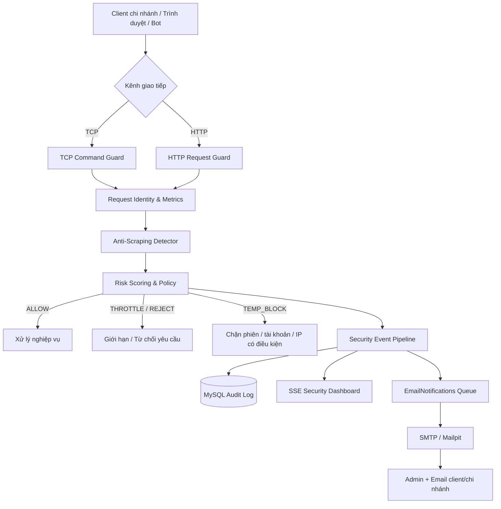
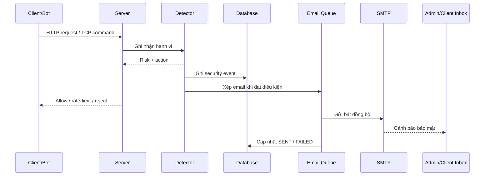

# KẾ HOẠCH TRIỂN KHAI ANTI-SCRAPING & CẢNH BÁO EMAIL

**Dự án:** System Validation Framework / hệ thống phân phối hàng hóa  
**Phiên bản tài liệu:** 1.0  
**Ngày:** 26/10/2026  
**Phạm vi:** Java server, TCP client, HTTP API, giao diện Admin (React/TypeScript), MySQL, SMTP  
**Trạng thái:** Kế hoạch đề xuất — chưa triển khai các hạng mục mới.

---

## 1. Mục tiêu

Xây dựng lớp phòng chống thu thập dữ liệu tự động (anti-scraping) cho hệ thống phân phối, bảo đảm:

1. Phát hiện hành vi đọc dữ liệu với tần suất hoặc mẫu truy cập bất thường trên cả **TCP** và **HTTP**.
2. Hạn chế, từ chối hoặc tạm khóa đúng **phiên/tài khoản/IP** vi phạm theo mức độ rủi ro, không gây ảnh hưởng dây chuyền tới các chi nhánh chung địa chỉ NAT.
3. Hiển thị **cảnh báo gần thời gian thực** trên trang Giám sát an ninh của Admin.
4. Gửi **email tới quản trị viên và người phụ trách client/chi nhánh bị ảnh hưởng**, có chống gửi trùng và lưu kết quả gửi.
5. Lưu dấu vết đầy đủ để điều tra, thống kê và điều chỉnh ngưỡng nhằm giảm chặn nhầm.
6. Không làm gián đoạn luồng nghiệp vụ chính khi SMTP hoặc hệ thống lưu log gặp lỗi.

> **Quy ước người nhận:** “Gửi mail cho client” được hiểu là gửi cho email đã xác minh/cấu hình của **tài khoản hoặc chi nhánh có hoạt động truy xuất đáng ngờ / bị ảnh hưởng**; không tự động gửi thư đến địa chỉ của người lạ đang scraping. Nếu muốn người dùng tự nhận thông báo khóa quyền truy cập, thực hiện qua phản hồi API/UI trước; việc gửi email vẫn dựa vào danh tính đáng tin cậy.

## 2. Khảo sát source hiện có và nguyên tắc tận dụng

Đã đối chiếu tên tệp và một số phần triển khai trong bản ZIP `System-Validation-Framework(1).zip`.

| Thành phần hiện hữu | Vị trí | Nhận xét / kế hoạch |
|---|---|---|
| `SecurityMonitor.java` | `server/src/main/java/phanphoi/server/security/` | **Đã có** `onRead(...)` nhận diện `SCRAPING` cho `INVENTORY_GET` và `HISTORY_GET`; mở rộng tín hiệu thay vì thay thế toàn bộ. |
| `SecurityRules.java` | `server/.../security/` | **Đã có** `security.scrape.max.per.minute` (mặc định 30) và `security.scrape.history.max.days` (mặc định 366); bổ sung cấu hình theo lệnh và độ rủi ro. |
| `RateCounter.java` | `server/.../security/` | **Đã có** bộ đếm cửa sổ trượt trong bộ nhớ; tái sử dụng, mở rộng bộ đếm theo tài khoản/endpoint. |
| `BanList.java` | `server/.../security/` | **Đã có** tạm chặn IP trong bộ nhớ; cân nhắc lưu trạng thái vào DB và hỗ trợ theo session/account. |
| `SecurityEventLog.java`, `SecurityEvent.java` | `server/.../security/` | Tận dụng pipeline sự kiện hiện tại; bổ sung metadata có cấu trúc. |
| `SessionRegistry.java` | `server/src/main/java/phanphoi/server/net/` | Kết nối danh tính phiên TCP và IP; tránh chặn nhầm các phiên chung NAT. |
| `Router.java`, `SseHub.java` | `common/src/main/java/phanphoi/common/web/` | Tích hợp HTTP guard và đẩy sự kiện gần thời gian thực; xem xét điểm móc thực tế trước khi sửa. |
| `EmailNotifications.java`, `EmailSender.java`, `SmtpEmailSender.java` | `server/src/main/java/phanphoi/server/mail/` | **Đã có** hàng đợi SMTP bất đồng bộ và cảnh báo đăng nhập. Bổ sung cảnh báo scraping vào hệ thống này. |
| `Security.tsx` | `ui/components/admin/` | Mở rộng dashboard; không xây thêm trang hoàn toàn tách rời nếu không cần. |
| `docs/EMAIL.md` | `docs/` | Đã mô tả cấu hình `MAIL_ADMIN_RECIPIENTS`, `MAIL_BRANCH_RECIPIENTS` và chạy thử Mailpit. |
| `config/server.properties` | `config/` | Hiện có `security.mode=block` và ngưỡng scraping TCP; không bật thay đổi chính sách mới trực tiếp ở production. |

**Lưu ý:** Hệ thống **không bắt đầu từ số 0**: detection `SCRAPING` TCP đã hiện hữu. Các phần `RiskScoreCalculator`, phân tích hành vi nâng cao, dashboard và email scraping phía dưới là **đề xuất cần phát triển**, không phải tính năng đã có sẵn.

### 2.1. Hạn chế hiện tại cần giải quyết

- Quy tắc scraping hiện có tập trung vào **số lần đọc trên một phiên TCP trong 60 giây** và độ dài khoảng thời gian của `HISTORY_GET`.
- Chưa có bằng chứng từ phần code được rà soát cho thấy một lớp **phát hiện thống nhất HTTP + TCP** theo danh tính tài khoản và hành vi tổng hợp.
- Email trong `EmailNotifications.onSecurityEvent(...)` hiện chỉ gửi cho các loại sự kiện đăng nhập: `BRUTE_FORCE`, `CRED_STUFFING`, `ADMIN_BRUTE_FORCE`, `LOGIN_NEW_IP`; **chưa gồm `SCRAPING`**.
- `BanList` hiện lưu IP trong RAM; restart server làm mất trạng thái chặn.
- Cần phân biệt truy cập thật của chi nhánh, các tác vụ đồng bộ hợp lệ và bot nhằm giảm false positive.

## 3. Kiến trúc mục tiêu



### 3.1. Nguyên tắc thiết kế

- **Fast path:** Kiểm tra request nhanh, dùng bộ nhớ hoặc cache; không thực hiện SMTP trên luồng HTTP/TCP hay trong DB transaction.
- **Identity-aware:** Đếm theo phiên, tài khoản, chi nhánh, IP và endpoint/command; hạn chế chỉ dựa vào IP.
- **Defense in depth:** Kiểm soát quyền, phân trang, giới hạn xuất dữ liệu, ngăn đoán ID và rate limiting.
- **Fail-safe:** Hệ thống giám sát lỗi không được làm rơi giao dịch hợp lệ; chính sách fail-open/fail-closed phải xác định rõ cho từng đường truy cập.
- **Deploy an toàn:** Bắt đầu ở chế độ quan sát trước khi kích hoạt quy tắc chặn mới.
- **Riêng tư:** Không ghi mật khẩu, token, payload nhạy cảm hoặc dữ liệu khách hàng đầy đủ vào log/email.

## 4. Phát hiện scraping

### 4.1. Các tín hiệu

| Tín hiệu | Ví dụ | Cách theo dõi |
|---|---|---|
| Tần suất đọc dữ liệu cao | 100 request/phút vào endpoint danh sách | Sliding window / Token Bucket |
| Duyệt bản ghi tuần tự | `id=1,2,3,...` với tỷ lệ 404/403 lớn | Theo dõi mẫu truy vấn trong phiên |
| Phân trang sâu, đọc toàn bộ tập dữ liệu | Page 1→500 trong thời gian ngắn | Tổng trang, số dòng trả về, bytes xuất |
| Khoảng cách request đều như máy | 1 request mỗi 200 ms trong thời gian dài | Phân bố khoảng cách request |
| Nhiều session/IP chung tài khoản | Đọc đồng thời từ nhiều IP | Tổng hợp theo `accountId` |
| Vượt ngưỡng nhưng vẫn thử tiếp | Tiếp tục truy cập sau `429` / mã lỗi TCP | Số lần vi phạm trong cửa sổ |
| Đòi dữ liệu quá rộng | `HISTORY_GET` khoảng thời gian bất thường | Giới hạn thời gian, pagination, nghiệp vụ |
| Thử truy cập sai quyền | Đọc ID thuộc chi nhánh khác | Tái sử dụng quy tắc IDOR hiện có |

**Ngoại lệ hợp lệ:** Truy cập do đồng bộ dữ liệu, import/export được Admin cấp quyền, job định kỳ hoặc nhiều người chung mạng NAT; định nghĩa theo tài khoản, loại nghiệp vụ và quota được xác thực. Không chỉ whitelist IP.

### 4.2. Rate limiting hai tầng

1. **Giới hạn cứng theo API/command** — áp dụng ngay để bảo vệ tài nguyên nặng; ví dụ kích thước trang tối đa, số bản ghi xuất, cửa sổ lịch sử, thời gian chạy truy vấn.
2. **Ngưỡng phát hiện tổng hợp** — cảnh báo theo cửa sổ ngắn và dài dựa trên tài khoản/phiên/IP, có xét rủi ro và mẫu truy cập.

**Ngưỡng ví dụ cho các endpoint đọc dữ liệu thông thường** (cần đo lưu lượng trước khi áp dụng):

| Request/phút | Mức | Hành động đề xuất |
|---:|---|---|
| ≤ 30 | Normal | Cho phép |
| 31–60 | Observe | Ghi metrics, tăng giám sát |
| 61–120 | Warning | Cảnh báo + áp dụng throttling chọn lọc |
| > 120 | High | Tạm từ chối request/khóa phiên nếu có nhiều tín hiệu phù hợp |

**Quan trọng:** Ngưỡng `security.scrape.max.per.minute=30` hiện hữu đã áp dụng với TCP `onRead(...)`. Bảng trên chỉ là **phác thảo chính sách mở rộng** cho nhóm endpoint/command được cấu hình và **không tự động thay thế** giá trị đang chạy. Endpoint trọng yếu cần quota riêng.

### 4.3. Risk scoring (V1 đề xuất)

| Tín hiệu | Điểm tham khảo |
|---|---:|
| Vượt quota theo tài khoản | +25 |
| Duyệt ID tuần tự bất thường | +20 |
| Nhịp request đều bất thường kéo dài | +15 |
| Truy xuất lượng dữ liệu lớn liên tục | +20 |
| Nhiều IP/session cùng tải dữ liệu bằng một tài khoản | +15 |
| Tiếp tục truy cập sau khi bị giới hạn | +30 |

Điểm tổng hợp: `risk = min(100, tổng điểm các tín hiệu còn hiệu lực)`. Tín hiệu có TTL, giảm điểm theo thời gian và chỉ tính khi đủ bằng chứng tối thiểu để tránh cộng điểm lặp.

| Risk score | Phản ứng |
|---:|---|
| 0–39 | Allow / log bình thường |
| 40–69 | Observe / throttle / dashboard warning |
| 70–89 | Reject có thời hạn, cảnh báo Admin/client |
| 90–100 | Cô lập phiên, yêu cầu xác minh hoặc tạm khóa tài khoản có kiểm soát |

Không chặn dài hạn chỉ vì User-Agent lạ, đổi IP hay nhịp request đều; các tín hiệu này có khả năng false positive cao.

## 5. Chính sách phản ứng

### 5.1. Hành động

- **ALLOW:** Request được xử lý bình thường.
- **OBSERVE:** Chỉ ghi log và thống kê; không thay đổi phản hồi cho client.
- **THROTTLE:** Hạ tốc độ theo token bucket/quota; phản hồi HTTP `429 Too Many Requests` với `Retry-After` khi phù hợp.
- **REJECT:** Từ chối request hiện tại; với TCP tái sử dụng cơ chế báo lỗi hiện có (cần kiểm tra mapping error code tại điểm gọi).
- **KICK_SESSION:** Ngắt đúng phiên gây vi phạm nặng.
- **TEMP_BLOCK:** Tạm chặn IP/tài khoản/phiên khi có đủ tín hiệu và ghi lý do, thời gian hết hạn.
- **MANUAL_REVIEW:** Cho phép Admin kiểm tra, bỏ chặn và ghi lại lý do.

### 5.2. Tránh chặn nhầm

- Không khóa cả IP NAT khi vẫn có các phiên chi nhánh hợp lệ; giữ nguyên ưu tiên an toàn đã có trong `SecurityMonitor`.
- Nếu một tài khoản có nhiều session khác thường: ưu tiên từ chối session gây vi phạm thay vì khóa tất cả.
- Danh sách miễn trừ phải có chủ sở hữu, hạn dùng và audit log; không miễn trừ mọi hành vi của tài khoản Admin.
- Có mốc khởi tạo quota và cảnh báo riêng cho các job đồng bộ, export hợp lệ.
- Nếu triển khai nhiều server, bộ đếm in-memory không đủ để áp quota toàn cụm: cần Redis hoặc giải pháp chia sẻ trạng thái tương đương.

## 6. Cảnh báo realtime trên Admin Dashboard

**Điểm mở rộng:** `ui/components/admin/Security.tsx` + API Admin hiện có + hạ tầng SSE (`SseHub`).

### 6.1. Thống kê

- Request/phút và xu hướng 5 phút, 1 giờ, 24 giờ.
- Số sự kiện `SCRAPING` theo mức độ và nguồn HTTP/TCP.
- Số IP, tài khoản, phiên bị rate-limit / tạm khóa.
- Top endpoint/command bị đọc nhiều.
- Tỷ lệ cảnh báo đúng/sai theo đánh dấu của Admin.
- Số email `queued`, `sent`, `failed`, `suppressed`.

### 6.2. Bảng sự kiện

Các cột đề xuất: `Time`, `Event ID`, `Severity`, `Client/Branch`, `Masked IP`, `Source`, `Command/Endpoint`, `Request rate`, `Risk score`, `Action`, `Email status`.

**Tính năng:** lọc, xem chi tiết, xuất báo cáo đã ẩn dữ liệu nhạy cảm, bỏ chặn/thay đổi thời hạn chặn theo quyền Admin, đánh dấu false positive và xem lịch sử xử lý.

**Realtime:** phát sự kiện sau khi được chuẩn hóa trong pipeline; SSE có thể reconnect và nhận snapshot, tránh lệ thuộc hoàn toàn vào stream.

## 7. Gửi email cảnh báo cho client và Admin

### 7.1. Đối tượng nhận

| Tình huống | Admin | Client/chi nhánh | Kỹ thuật |
|---|---|---|---|
| Risk 40–69, chưa chặn | Dashboard; có thể email dạng tổng hợp | Không gửi ngay | Không bắt buộc |
| Risk ≥ 70, đã giới hạn hoặc chặn | Email ngay | Email tới người phụ trách chi nhánh/tài khoản liên quan | Tùy cấu hình |
| Risk ≥ 90 hoặc scraping diện rộng | Email khẩn cấp | Email cho chủ tài khoản bị ảnh hưởng | Email khẩn cấp |
| Sự kiện giống hệt lặp lại | Gộp cảnh báo | Chống gửi trùng | Gộp theo chiến dịch |

**Nguồn email nhận:** tái sử dụng `MAIL_ADMIN_RECIPIENTS` và `MAIL_BRANCH_RECIPIENTS` trong cơ chế hiện có. Email client phải thuộc danh sách cấu hình đã được quản trị/xác minh; không lấy email từ body/header request để tránh email bombing.

### 7.2. Luồng gửi



Không đợi email được gửi xong mới phản hồi request; phải có metrics riêng cho việc xếp hàng và gửi thành công.

### 7.3. Template email mẫu

**Subject:** `[SECURITY ALERT] Phát hiện truy xuất dữ liệu bất thường - CN01`

```text
Kính gửi người phụ trách CN01,

Hệ thống vừa phát hiện hoạt động truy xuất dữ liệu có dấu hiệu bất thường
liên quan đến tài khoản/chi nhánh của Quý khách.

Mã sự kiện  : SEC-2026-00125
Thời gian   : 26/10/2026 09:30 (GMT+7)
Chi nhánh   : CN01
Nguồn       : TCP / INVENTORY_GET
IP ghi nhận : 203.0.113.24
Tần suất    : 185 yêu cầu/phút
Mức rủi ro  : HIGH
Xử lý       : Đã giới hạn truy cập trong 15 phút

Nếu đây là thao tác hợp lệ, vui lòng liên hệ quản trị viên
để được xem xét và bỏ chặn.
Nếu không nhận ra hoạt động này, hãy kiểm tra phiên đăng nhập,
đổi mật khẩu và thông báo cho bộ phận quản trị.

Đây là email tự động, không chứa dữ liệu hàng hóa hoặc thông tin đăng nhập.
```

### 7.4. Chống spam email và độ tin cậy

- Chống gửi trùng theo `eventType + branch/account + recipient + severity` trong 15 phút (cấu hình được).
- Khi nâng mức từ `MEDIUM` lên `CRITICAL`, được phép gửi email mới ngay.
- Gom tóm tắt theo khoảng thời gian cho các event lặp lại; giới hạn tổng email/giờ/người nhận.
- Hàng đợi có giới hạn; nếu queue đầy thì ghi metrics và tạo sự kiện vận hành.
- Retry có backoff, giới hạn số lần; phân biệt lỗi SMTP tạm thời và lỗi cấu hình vĩnh viễn.
- Nếu cần bảo đảm không mất cảnh báo sau restart, dùng **DB outbox** (khuyến nghị) thay vì chỉ dựa vào queue trong RAM.
- Không log SMTP password, token, mật khẩu người dùng hoặc nội dung truy vấn nhạy cảm.
- Thử Mailpit trước khi bật gửi email thật; tuân thủ hướng dẫn trong `docs/EMAIL.md`.

## 8. Thiết kế dữ liệu

Ưu tiên **mở rộng bảng security event hiện hữu** nếu schema đáp ứng được; không tạo bảng trùng lặp. Nếu thiếu cấu trúc có thể bổ sung migration riêng.

### 8.1. Bảng/đối tượng đề xuất

| Bảng | Trường gợi ý | Ghi chú |
|---|---|---|
| `security_scraping_details` | `id`, `security_event_id`, `account_id`, `branch_code`, `source`, `resource`, `risk_score`, `request_count`, `window_seconds`, `bytes_sent`, `created_at` | Chỉ lập nếu bảng event hiện hữu chưa đủ metadata. |
| `security_blocks` | `id`, `target_type`, `target_hash`, `reason`, `created_at`, `expires_at`, `revoked_at`, `revoked_by` | Theo dõi chặn và bỏ chặn. |
| `security_email_outbox` | `id`, `event_id`, `recipient`, `template_key`, `status`, `attempt_count`, `next_attempt_at`, `sent_at`, `last_error` | Cho gửi email bền vững. |
| `security_policy_exemptions` (tùy chọn) | `id`, `scope`, `subject`, `reason`, `expires_at`, `approved_by` | Quản lý ngoại lệ cho job hợp lệ. |

**Index gợi ý:** `(created_at)`, `(branch_code, created_at)`, `(account_id, created_at)`, `(status, next_attempt_at)` và khóa duy nhất chống gửi trùng nếu sử dụng DB outbox.

**Retention đề xuất:** 30–90 ngày cho sự kiện chi tiết và metadata IP (tùy chính sách); báo cáo tổng hợp được giữ lâu hơn nếu không chứa dữ liệu cá nhân.

## 9. Các module/code cần triển khai

> Các đường dẫn `[NEW]` là định hướng; tên class cuối cùng cần tuân theo cấu trúc source hiện hành và tránh trùng logic.

```text
server/src/main/java/phanphoi/server/
├── security/
│   ├── SecurityMonitor.java          [MODIFY - mở rộng onRead/pipeline]
│   ├── SecurityRules.java            [MODIFY - chính sách cấu hình]
│   ├── RateCounter.java              [REUSE / MODIFY nếu cần]
│   ├── BanList.java                  [MODIFY - chặn theo đối tượng / persistence]
│   ├── SecurityEvent.java            [MODIFY nếu thêm metadata]
│   ├── SecurityEventLog.java         [MODIFY nếu thêm audit]
│   └── scraping/                    [NEW]
│       ├── ScrapingDetector.java
│       ├── RequestTracker.java
│       ├── BehaviorAnalyzer.java
│       ├── RiskScoreCalculator.java
│       ├── ScrapingPolicy.java
│       └── ScrapingDecision.java
├── mail/
│   ├── EmailNotifications.java       [MODIFY - tích hợp SCRAPING]
│   └── ScrapingAlertTemplate.java    [NEW]
├── AdminApi.java                     [MODIFY - API cho dashboard]
└── ServerContext.java                [MODIFY - dependency wiring]

common/src/main/java/phanphoi/common/web/
└── Router.java                       [MODIFY nếu cần hook HTTP]

ui/components/admin/
└── Security.tsx                      [MODIFY]

db/
└── migrate_anti_scraping.sql         [NEW - sau khi rà soát schema]

config/
└── server.properties                 [MODIFY]

docs/
└── ANTI_SCRAPING.md                  [NEW - tài liệu vận hành sau triển khai]
```

### 9.1. Các điểm tích hợp cần kiểm tra trước khi sửa

1. Xác định nơi gọi `SecurityMonitor.onRead(...)` trong luồng TCP để không tính trùng request.
2. Tìm các route HTTP đọc dữ liệu cần bảo vệ và cơ chế phân quyền sẵn có.
3. Xác định `AdminApi` phát API bảo mật hiện tại và SSE event format tương thích UI.
4. Kiểm tra schema `db/schema.sql`, migration và cơ chế ghi của `SecurityEventLog` để tránh tạo hệ thống log song song.
5. Kiểm tra các trường `maCn`/account trong `SecurityEvent` để chọn đúng người nhận email.
6. Giữ cấu hình `MAIL_*` và tái dùng queue/SMTP hiện hữu; chỉ xây outbox mới nếu có yêu cầu bền vững sau restart.

## 10. Cấu hình đề xuất

**Không đổi trực tiếp các giá trị đang chạy khi chưa đo lưu lượng thực tế.** Các khóa `scraping.*` dưới đây là **đề xuất mới**; cần implement parser và validator trong source nếu sử dụng.

```properties
# Hệ thống hiện tại (giữ và đánh giá lại)
security.mode=detect
security.scrape.max.per.minute=30
security.scrape.history.max.days=366

# Anti-scraping mở rộng - đề xuất mới
scraping.enabled=true
scraping.http.enabled=true
scraping.tcp.enabled=true
scraping.mode=detect
scraping.window.seconds=60
scraping.risk.warning=40
scraping.risk.block=70
scraping.block.duration.seconds=900
scraping.email.enabled=true
scraping.email.cooldown.seconds=900
scraping.log.retention.days=30
```

**Quan trọng:** `security.mode` hiện tại của dự án chỉ hỗ trợ `off | detect | block` (theo `SecurityRules.Mode`), **không phải** `monitor | enforce`. Nếu sử dụng `scraping.mode` riêng, ánh xạ rõ `detect` = ghi nhận và `block` = áp dụng giới hạn.

Các giá trị `MAIL_ENABLED`, `MAIL_ADMIN_RECIPIENTS`, `MAIL_BRANCH_RECIPIENTS` và SMTP giữ theo tài liệu email hiện có. Không lưu thông tin xác thực SMTP thật trong repository.

## 11. API/Admin đề xuất

| Endpoint gợi ý | Method | Chức năng | Quyền |
|---|---|---|---|
| `/admin/api/security/scraping/summary` | GET | KPI và tổng hợp sự kiện | Admin |
| `/admin/api/security/scraping/events` | GET | Danh sách sự kiện có phân trang/lọc | Admin |
| `/admin/api/security/scraping/events/{id}` | GET | Chi tiết sự kiện | Admin |
| `/admin/api/security/scraping/blocks` | GET | Danh sách đang chặn | Admin |
| `/admin/api/security/scraping/blocks/{id}/revoke` | POST | Bỏ chặn có ghi lý do | Admin |
| `/admin/api/security/scraping/events/{id}/review` | POST | Đánh dấu đúng/sai | Admin |

Đường dẫn trên chỉ là thiết kế gợi ý, cần điều chỉnh theo convention routing của dự án. Các API thao tác phải kiểm tra xác thực, CSRF/cơ chế tương ứng, phân quyền, audit và pagination; không công khai cho tài khoản chi nhánh.

## 12. Kế hoạch triển khai theo giai đoạn

| Giai đoạn | Nội dung | Đầu ra | Ước tính |
|---|---|---|---:|
| **1. Audit** | Phân tích code TCP/HTTP, schema, SMTP, benchmark tải hợp lệ, xác định endpoint rủi ro. | Danh sách điểm móc + baseline traffic. | 1–2 ngày |
| **2. Detection** | RequestTracker, tín hiệu hành vi, scoring, ngưỡng theo command/endpoint. | Bộ phát hiện với unit test, chạy ở detect mode. | 3–4 ngày |
| **3. Blocking + DB** | Chính sách allow/throttle/reject/ban, tránh NAT false positive, migration/audit. | Enforcement tùy chọn, logs truy vết. | 1–2 ngày |
| **4. Email** | Cảnh báo `SCRAPING`, danh sách người nhận, template, dedupe, retry/outbox tùy yêu cầu. | Email thử qua Mailpit, test SMTP lỗi. | 1–2 ngày |
| **5. Dashboard** | KPI, events, SSE, lọc và thao tác bỏ chặn. | Giao diện security mới. | 2–3 ngày |
| **6. Test & rollout** | Test chức năng, tải, tấn công giả lập, false positive, bật enforce có kiểm soát. | Báo cáo nghiệm thu, hướng dẫn vận hành. | 2–3 ngày |

**Tổng ước tính:** 10–16 ngày làm việc; có thể rút ngắn nếu chỉ triển khai V1 (TCP scraping hiện có + email + dashboard) trước.

### Mức độ ưu tiên

**P0 — Nên triển khai đầu tiên:**
- Tái sử dụng sự kiện `SCRAPING` sẵn có, bổ sung email tới admin và chi nhánh.
- Chống gửi email trùng và kiểm tra với Mailpit.
- Hiển thị đầy đủ event scraping trên Security dashboard.
- Giữ nguyên nguyên tắc không chặn chung NAT.

**P1 — Mở rộng quan trọng:**
- Bảo vệ endpoint HTTP đọc dữ liệu.
- Tổng hợp hành vi theo session, tài khoản, chi nhánh, không chỉ theo IP.
- Quota theo tài nguyên, risk scoring, thay đổi ngưỡng cấu hình.
- Lưu trạng thái block và có thao tác gỡ chặn ở Admin.

**P2 — Nâng cao:**
- DB outbox bền vững, phân tích dữ liệu lớn, phát hiện chiến dịch nhiều IP, báo cáo xu hướng.
- Hỗ trợ multi-instance (Redis/shared limiter), rule tuning và tự động phát hiện false positive.

## 13. Kiểm thử và nghiệm thu

| ID | Kịch bản | Kết quả mong đợi |
|---|---|---|
| T01 | Client đọc hàng hóa với lưu lượng bình thường | Không bị chặn hoặc cảnh báo sai |
| T02 | `INVENTORY_GET` vượt ngưỡng TCP hiện tại | Tạo `SCRAPING`, hành động theo `security.mode` |
| T03 | `HISTORY_GET` yêu cầu thời gian quá rộng | Tạo sự kiện/giới hạn đúng quy tắc |
| T04 | HTTP liên tục đọc danh sách vượt quota mới | Bị throttle/429 (khi bật block) |
| T05 | Bot quét ID không thuộc quyền | Kích hoạt giám sát IDOR và scraping phù hợp |
| T06 | Hai chi nhánh cùng NAT, một phiên vi phạm | Không chặn nhầm phiên hợp lệ của chi nhánh khác |
| T07 | Một tài khoản chạy nhiều session/IP | Có phát hiện tổng hợp, không chỉ đếm từng IP |
| T08 | Risk High | Admin và client liên quan nhận email phù hợp |
| T09 | Lặp hàng trăm event cùng loại | Email được gộp/chống gửi trùng |
| T10 | SMTP down / Mailpit dừng | HTTP/TCP vẫn hoạt động, email ghi FAILED/retry đúng |
| T11 | Server restart trong khi có block | Block tiếp tục hiệu lực nếu persistence được bật |
| T12 | Admin bỏ chặn | Hết hạn chế theo policy và có audit log |
| T13 | Dashboard mất SSE rồi reconnect | Xem lại snapshot, không mất khả năng tra cứu event |
| T14 | Gửi mail với dữ liệu bất thường | Không lộ token/password, tránh HTML injection/header injection |
| T15 | Test load hợp lệ (đồng bộ hàng loạt) | Độ trễ và tỷ lệ lỗi trong ngưỡng chấp nhận được |

**Tiêu chí đạt:**
- 100% kịch bản P0 có kiểm thử tự động hoặc nghiệm thu thủ công có biên bản.
- Không có lỗi chặn nhầm trong các kịch bản đồng bộ hợp lệ đã định nghĩa.
- Các sự kiện High được hiển thị và xếp email đúng người nhận theo quy tắc chống trùng.
- Gửi mail lỗi không chặn luồng nghiệp vụ.
- Chứng minh được event, hành động xử lý, người nhận và trạng thái email bằng log/audit.
- Số liệu tốc độ phát hiện và false positive phải **đo khi thử nghiệm**, không cam kết tỷ lệ tùy ý trước khi có dataset kiểm thử.

## 14. Vận hành, bảo mật và triển khai

1. **Local/dev:** Dùng chế độ `detect`, Docker Compose + Mailpit; test theo `docs/EMAIL.md`.
2. **Staging:** Chạy bộ mô phỏng với traffic người dùng hợp lệ và scraper giả lập; hiệu chỉnh quota.
3. **Canary:** Bật `block` chỉ cho một số endpoint/command, theo dõi false positive và latency.
4. **Production:** Mở rộng bảo vệ theo kết quả test; đặt cảnh báo khi event tăng đột biến hoặc email queue đầy.
5. **Rollback:** Chuyển quy tắc mới về `detect` qua cấu hình; giữ nguyên log và hệ thống email cảnh báo nếu phù hợp.
6. **Đảm bảo an toàn:** HTTPS cho HTTP, cấu hình trusted reverse proxy rõ ràng; không mặc định tin header `X-Forwarded-For` do client tự khai; không gửi dữ liệu nghiệp vụ nhạy cảm trong email.
7. **Giám sát tài nguyên:** Mỗi bộ đếm hành vi phải có TTL, giới hạn bộ nhớ và chiến lược dọn dẹp nhằm tránh bị tấn công làm cạn RAM.

## 15. Deliverables

- [ ] Code detector chung và các hook TCP/HTTP cần thiết.
- [ ] Rules/config có giải thích rõ từng ngưỡng và mode.
- [ ] Security event + audit + block lifecycle.
- [ ] Email `SCRAPING` tới Admin/chi nhánh và chống gửi trùng.
- [ ] Dashboard Anti-Scraping và API Admin.
- [ ] Migration MySQL (nếu cần) và hướng dẫn backup/rollback.
- [ ] Unit tests, integration tests, kịch bản load/security.
- [ ] `docs/ANTI_SCRAPING.md` (vận hành thực tế, khi code đã hoàn thiện).

## 16. Kết luận và phương án khuyến nghị

**Nên triển khai V1 theo thứ tự:** tận dụng `SecurityMonitor.onRead(...)` sẵn có → phát sự kiện `SCRAPING` → tích hợp email đến Admin/client/chi nhánh bằng `EmailNotifications` → hoàn thiện trang `Security.tsx` → kiểm thử Mailpit và tránh false positive → mở rộng phát hiện trên HTTP và theo hành vi tài khoản.

Cách làm này cho kết quả sử dụng sớm, ít phá vỡ project hiện tại và có nền tảng để nâng cấp lên risk scoring, persistence và giám sát đa máy chủ.
