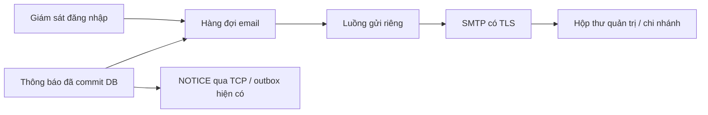

# Email cảnh báo đăng nhập và thông báo chi nhánh

## Tại sao cần email?

TCP/NOTICE và giao diện SSE hoạt động khi ứng dụng chi nhánh hoặc trang quản trị đang mở.
Email là kênh nhắc bổ sung khi người phụ trách không theo dõi giao diện hoặc chi nhánh đang offline.
Quản trị viên được nhắc kiểm tra đăng nhập bất thường sớm hơn; chi nhánh nhận được thông báo công ty
mà không cần giữ tab trình duyệt mở. Trạng thái nghiệp vụ và phản hồi vẫn do ứng dụng quản lý.

SMTP chạy trong **server Java**, không chạy trong React/Vite. Mật khẩu SMTP nằm ở backend.
Luồng TCP vẫn là đường trao đổi nghiệp vụ chính; không gửi dữ liệu đăng nhập/mật khẩu qua email.



## Hai luồng được triển khai

1. **Cảnh báo đăng nhập**: nhận các sự kiện `BRUTE_FORCE`, `CRED_STUFFING`, `ADMIN_BRUTE_FORCE`
   từ bộ giám sát hiện có, và `LOGIN_NEW_IP` khi đăng nhập thành công bằng IP khác lần trước.
   Gửi tới các email quản trị đã cấu hình và email chi nhánh liên quan (nếu có).
2. **Thông báo công ty**: tạo thành công `TIN`, `HOI_NHU_CAU` hoặc `SP_MOI` sẽ xếp email
   cho đúng các chi nhánh được chọn, song song với NOTICE qua TCP. Chỉ gửi sau commit tạo thông báo.
   Không gửi lại email mỗi lần resync, đăng nhập lại hoặc trả lời thông báo.

Đăng nhập lần đầu chỉ tạo mốc IP. Mốc lưu trong bộ nhớ, đặt lại khi server restart.
Đổi Wi-Fi, VPN, NAT hoặc địa chỉ container có thể là hoạt động hợp lệ; cảnh báo không khẳng định bị xâm nhập.
IP được nhìn từ socket phía server. Qua reverse proxy/NAT, nhiều người có thể hiện cùng IP;
hiện không tự tin tưởng `X-Forwarded-For` do client có thể giả mạo header.
`security.mode=off` tắt các sự kiện cảnh báo đăng nhập, nhưng thông báo email vẫn theo `mail.enabled`.

## Bàn giao và chọn cách nhận email

Push code, `.env.example`, hai file Compose và tài liệu này lên cùng nhánh bàn giao.
`.env.example` là mẫu cấu hình; người nhận tự copy thành `.env` ở gốc repo nếu chưa có file này,
rồi điền cấu hình trên máy chạy server. Không ghi đè `.env` đang dùng nếu chưa giữ lại cấu hình riêng.
Không push hoặc gửi kèm `.env` hiện tại chứa mật khẩu ứng dụng Gmail cá nhân.
Nhóm nên dùng tài khoản gửi thư do nhóm quản lý và tự cấu hình credential trên máy deploy.

| Mục đích | Cách chạy | Xem thư ở đâu? |
|---|---|---|
| Thử email bằng Mailpit, không cần Gmail | Dùng cả `docker-compose.yml` và `docker-compose.mailpit.yml` | `http://localhost:8025` trên máy chạy Docker |
| Nhận email thật bằng Gmail/Outlook | Điền SMTP và người nhận trong `.env`, chỉ dùng `docker-compose.yml` | Hộp thư thật của người nhận; kiểm tra cả Spam |

`localhost` luôn là máy đang mở trình duyệt. Khi Docker chạy trên máy bạn trong nhóm,
địa chỉ Mailpit trên máy bạn không tự trỏ tới máy đó. Cấu hình hiện tại chỉ mở Mailpit trên
loopback của máy chạy Docker; không công khai hộp thư thử ra Internet.

**Email nhận thông báo và tài khoản đăng nhập ứng dụng là hai việc riêng:**

- Hiện ứng dụng vẫn đăng nhập bằng `admin` hoặc mã chi nhánh như `CN01` cùng mật khẩu ứng dụng.
  Tính năng này chưa bổ sung đăng nhập bằng email, nút đăng nhập Google hoặc gửi OTP.
- Muốn một bạn nhận cảnh báo trong Gmail thật: cấu hình địa chỉ của bạn đó vào
  `MAIL_ADMIN_RECIPIENTS`, hoặc gắn với mã chi nhánh trong `MAIL_BRANCH_RECIPIENTS`.
  Ví dụ `CN01=ban-a@example.org;CN02=ban-b@example.org`.
- `MAIL_SMTP_USERNAME` và `MAIL_SMTP_PASSWORD` là tài khoản/mật khẩu của bên **gửi thư**.
  Người nhận chỉ cần cung cấp địa chỉ email, không cần cung cấp mật khẩu Gmail của họ.
- Email chi nhánh hiện được quản trị cấu hình trong `.env`, không tự lấy từ ô đăng nhập
  và chưa có màn hình cho từng người tự đổi địa chỉ email.

## Thử ngay bằng Docker và Mailpit

Tại thư mục gốc repo:

```powershell
docker compose -f docker-compose.yml -f docker-compose.mailpit.yml up --build -d
```

- Hộp thư thử: http://localhost:8025/ (xem mọi email thử).
- Công ty: http://localhost:8080/admin/.
- Chi nhánh: http://localhost:8081/branch/ hoặc http://localhost:8082/branch/.
- Người nhận mẫu: `admin@phanphoi.test`, `cn01@phanphoi.test`, `cn02@phanphoi.test`.

Mailpit nhận SMTP và lưu thư cục bộ; không gửi thư tới người thật. Không cần tài khoản Gmail.
Image dùng bản mirror chính thức `ghcr.io/axllent/mailpit:v1.27.4`, cùng phiên bản Mailpit,
để tránh phụ thuộc đường CDN Docker Hub khi gặp lỗi DNS `production.cloudfront.docker.com`.
Nếu cần kiểm tra riêng bước tải image, chạy `docker pull ghcr.io/axllent/mailpit:v1.27.4`.
Nếu dừng/chạy lại bản thử, tiếp tục dùng cả hai tham số `-f` để giữ cùng cấu hình.
Muốn chuyển về cấu hình trong `.env`, chạy `docker compose -f docker-compose.yml up -d`.
Email sẽ bật hoặc tắt theo `MAIL_ENABLED` trong `.env`; mẫu `.env.example` mặc định để `false`.

### Nghiệm thu thủ công

1. Đăng nhập công ty, vào Thông báo, gửi một `TIN` chỉ tới CN01.
   Hộp thư Mailpit có một email tới CN01, không có CN02. Nội dung tiếng Việt và tiêu đề đúng.
   Giao diện báo số thư **đã xếp hàng**, không khẳng định đã đến hộp thư người nhận.
2. Gửi tới cả CN01/CN02: mỗi chi nhánh nhận email riêng, không lộ địa chỉ chi nhánh khác.
3. Để CN01 offline rồi gửi thông báo: email vẫn được xếp gửi; NOTICE nhận khi đăng nhập lại.
4. Trong môi trường thử, nhập sai mật khẩu chi nhánh đủ ngưỡng `security.login.fail.max` (mặc định 5).
   Mailpit có cảnh báo BRUTE_FORCE tới quản trị và chi nhánh liên quan. IP có thể bị chặn theo cấu hình an ninh.
5. Thử sai mật khẩu quản trị đủ `admin.lock.fails` (mặc định 5): nhận ADMIN_BRUTE_FORCE, tài khoản bị khóa tạm.
6. Đăng nhập cùng tài khoản từ hai địa chỉ nguồn TCP khác nhau: nhận LOGIN_NEW_IP ở lần đổi IP.
   Đăng nhập lần đầu hoặc cùng IP không tạo loại cảnh báo này.
7. Dừng Mailpit rồi tạo thông báo: nghiệp vụ TCP/HTTP tiếp tục; email thử lại tối đa 3 lần và ghi số thất bại.
   Bật Mailpit lại chỉ phục vụ thư được xếp mới; thư đã thất bại không có nút phát lại tự động.

Sau khi đăng nhập công ty, `GET /api/mail/status` trả các bộ đếm:
`enabled`, `queued`, `pending`, `sent`, `failed`, `skipped`, `rejected`.
API này cần phiên quản trị và không trả mật khẩu hay danh sách email.
`sent` nghĩa là SMTP đã chấp nhận thư, không bảo đảm người nhận đã đọc hoặc thư không vào spam.

## Dùng SMTP thật khi deploy

Điền vào **`.env` ở gốc repo** khi chạy Docker (không phải `landing/.env.local`):

```dotenv
MAIL_ENABLED=true
MAIL_SMTP_HOST=smtp.example.org
MAIL_SMTP_PORT=587
MAIL_SMTP_SECURITY=starttls
MAIL_SMTP_USERNAME=your-smtp-user
MAIL_SMTP_PASSWORD=your-smtp-password
MAIL_FROM=notifications@example.org
MAIL_ADMIN_RECIPIENTS=admin@example.org
MAIL_BRANCH_RECIPIENTS=CN01=cn01@example.org;CN02=cn02@example.org
```

Các địa chỉ trên chỉ là ví dụ; thay bằng SMTP và hộp thư do nhóm quản lý, được phép nhận thông báo.
SMTP provider có thể yêu cầu mật khẩu ứng dụng/API credential và xác minh địa chỉ gửi.
Cấu hình TLS theo provider: `starttls` thường cổng 587, `ssl` thường cổng 465.
Server xác minh chứng chỉ; STARTTLS phải nâng cấp TLS thành công mới tiếp tục.
`none` dành cho SMTP thử không xác thực; không cho gửi username/password khi chưa có TLS.

```powershell
docker compose up --build -d
```

### Ví dụ Gmail thật và chuyển qua lại với Mailpit

Với tài khoản Gmail hỗ trợ mật khẩu ứng dụng, bật xác minh 2 bước rồi tạo mật khẩu ứng dụng
theo [hướng dẫn Google](https://support.google.com/accounts/answer/185833?hl=vi).
Điền mật khẩu ứng dụng vào `.env`, không dùng mật khẩu đăng nhập Gmail thông thường.
Nhập liền các ký tự mật khẩu ứng dụng, bỏ dấu cách phân nhóm.

```dotenv
MAIL_ENABLED=true
MAIL_SMTP_HOST=smtp.gmail.com
MAIL_SMTP_PORT=587
MAIL_SMTP_SECURITY=starttls
MAIL_SMTP_USERNAME=your-sender@gmail.com
MAIL_SMTP_PASSWORD=YOUR_APP_PASSWORD
MAIL_FROM=your-sender@gmail.com
MAIL_ADMIN_RECIPIENTS=your-admin@example.org
MAIL_BRANCH_RECIPIENTS=CN01=your-recipient@example.org
```

Thay các giá trị mẫu bằng tài khoản gửi và địa chỉ người nhận thật. Để tự test một mình,
có thể dùng cùng một địa chỉ Gmail cho người gửi, quản trị và người nhận CN01.
Chỉ CN01 có ánh xạ trong ví dụ này; gửi thông báo riêng CN02 sẽ không tạo email cho CN02.

- **Chuyển sang Gmail thật:** chạy `docker compose -f docker-compose.yml up -d`.
  Không thêm file Mailpit vì file đó ghi đè SMTP, bật mail thử và thay người nhận bằng địa chỉ `.test`.
- **Chuyển về Mailpit:** chạy
  `docker compose -f docker-compose.yml -f docker-compose.mailpit.yml up -d`.
  Cấu hình Gmail trong `.env` được giữ lại nhưng bị cấu hình Mailpit ghi đè khi chạy lệnh này.
- Chỉ sửa `.env`/biến môi trường thì dùng `up -d` để Compose áp dụng lại; `restart` không nạp
  giá trị biến môi trường mới. Khi sửa code hoặc file cấu hình đóng gói trong image, thêm `--build`.
- Sau mỗi lần chuyển, tạo **thông báo mới** cho CN01 để thử rồi kiểm tra hộp thư tương ứng.
  Thư cũ trong Mailpit và thông báo tạo khi mail tắt không tự chuyển sang Gmail.
  Mailpit có thể vẫn chạy sau khi chuyển sang Gmail; việc mở được cổng 8025 không có nghĩa
  server đang gửi thư vào Mailpit.

Nếu không thấy thư, đăng nhập quản trị rồi kiểm tra `/api/mail/status`:
`enabled=false` nghĩa là mail đang tắt; `failed` tăng nghĩa là có lỗi gửi;
`sent` tăng chỉ xác nhận SMTP đã chấp nhận thư, cần kiểm tra Hộp thư đến/Spam để xác nhận thư tới nơi.

### Chạy Java trực tiếp

Với Java chạy trực tiếp, dùng các khóa tương ứng trong `config/server.local.properties`:

```properties
mail.enabled=true
mail.smtp.host=smtp.example.org
mail.smtp.port=587
mail.smtp.security=starttls
mail.smtp.username=your-smtp-user
mail.smtp.password=your-smtp-password
mail.from=notifications@example.org
mail.admin.recipients=admin@example.org
mail.branch.recipients=CN01=cn01@example.org;CN02=cn02@example.org
```

Backend cũng đọc các biến `MAIL_*` như Docker; biến môi trường ưu tiên hơn file properties.
`.env` do Docker Compose nạp; Java chạy trực tiếp không tự đọc `.env`.
Không commit cấu hình bí mật. Không đưa SMTP credential vào biến `VITE_*` vì các biến đó công khai trong bundle.

## Vị trí code và giới hạn

- `server/mail/MailSettings`: đọc/kiểm tra địa chỉ, TLS, timeout và biến môi trường.
- `SmtpEmailSender`: Jakarta Mail/Angus SMTP, email UTF-8 dạng text.
- `EmailNotifications`: một worker, hàng đợi hữu hạn, retry và chống lặp.
- `ServerContext`: nối sự kiện an ninh với email, vẫn giữ DB log và SSE.
- `SecurityMonitor.onSuccessfulLogin`: so sánh IP, ghi LOGIN_NEW_IP.
- `NoticeService.create`: chỉ xếp email sau transaction tạo NOTICE thành công.

Hàng đợi mặc định 200 thư, timeout mỗi thao tác SMTP 5 giây; retry tối đa 3 lần.
Hàng đợi đầy thì từ chối thư mới và tăng `rejected`, không chặn Selector hoặc làm rollback thông báo.
Cảnh báo cùng loại/người nhận có cooldown mặc định 300 giây để tránh ngập mail khi bị tấn công.
Các sự kiện khác trong khoảng này vẫn xem được ở trang Giám sát an ninh.
Thông báo cùng mã/chi nhánh được chống lặp bằng cache hữu hạn trong 24 giờ, không bảo đảm exactly-once.

Đây là hàng đợi trong bộ nhớ: server tắt đột ngột có thể mất thư đang chờ;
thư đã gửi nhưng SMTP trả lỗi mơ hồ có thể bị gửi lặp khi retry. Email không thay thế outbox/trạng thái DB.
Nếu cần bảo đảm giao thư qua restart hoặc audit đầy đủ theo từng email, bước tiếp theo là outbox email bền vững trong DB.

Kiểm thử tự động dùng SMTP cục bộ trong unit test, không gửi tới tài khoản Internet.
Chạy `mvn -pl server -am test`; kiểm thử SMTP xác nhận tiêu đề/body UTF-8 và người nhận,
định tuyến chi nhánh, chống lặp, retry, queue đầy và phát hiện đổi IP.

Tham khảo: [Angus SMTP](https://eclipse-ee4j.github.io/angus-mail/docs/api/org.eclipse.angus.mail/org/eclipse/angus/mail/smtp/package-summary.html),
[Mailpit Docker](https://mailpit.axllent.org/docs/install/docker/).

## Kết quả kiểm tra ngày 26/10/2026

- `mvn -B package`: thành công cả common, server, client và loadsim; **141 test qua**
  (common 78, server 49, client 14). Trong đó có 12 test mới cho mail và đổi IP đăng nhập.
- SMTP test dùng socket cục bộ và Angus Mail thật, kiểm tra email nhận được có tiêu đề/body UTF-8
  và đúng một người nhận. Không gửi email tới Internet.
- Test định tuyến chỉ gửi chi nhánh được chọn, bỏ qua địa chỉ chưa cấu hình, chống lặp,
  cooldown cảnh báo, retry, queue đầy/đóng và bộ đếm thất bại đều qua.
- Trong thư mục `ui/`, `npm run typecheck` và `npm run build`: thành công. Next.js có cảnh báo CSS
  autoprefixer sẵn có ở `globals.css` về giá trị `end`, không làm build thất bại.
- `docker compose -f docker-compose.yml -f docker-compose.mailpit.yml config --quiet`: hợp lệ.
- JAR server có Jakarta Mail, activation và SPI SMTP cần thiết sau shade.

- Demo Compose/Mailpit đã chạy thành công với đủ 5 container: db, server, cn01, cn02 và mailpit.
  Sau lỗi DNS tải image qua Docker Hub, đã dùng mirror chính thức
  `ghcr.io/axllent/mailpit:v1.27.4`, giữ nguyên phiên bản.
- Đã đăng nhập admin, tạo thông báo thử số 1 cho riêng CN01 qua API của ứng dụng và xác nhận
  Mailpit nhận đúng một thư tới `cn01@phanphoi.test`, tiêu đề tiếng Việt hiển thị đúng UTF-8.
  `/api/mail/status` trả `queued=1`, `sent=1`, `failed=0`, `pending=0`, `rejected=0`.
  Thư thử được giữ trong Mailpit để kiểm tra tại `http://localhost:8025`.

- Đã gửi thông báo thử số 4 qua SMTP Gmail sau khi bật `MAIL_ENABLED` và áp dụng lại server:
  `sent=1`, `failed=0`, `pending=0`. Kết quả này xác nhận Gmail SMTP chấp nhận thư;
  chưa xác nhận độc lập vị trí thư trong hộp thư người nhận. Chưa thử Outlook.
- Người dùng đã báo test thành công các cảnh báo đăng nhập trong phiên làm việc;
  các kết quả unit test và phép thử SMTP tự động nêu trên được kiểm tra riêng.

Thay đổi email ở backend không được chứa trong ZIP `landing/dist`; khi deploy cần build lại image server.

## Khởi động lại server để test lại

Trạng thái khóa quản trị, chặn IP, mốc IP đăng nhập và cooldown email nằm trong bộ nhớ.
Restart server sẽ đặt lại các trạng thái này; database vẫn giữ nguyên.
Khi đang dùng Mailpit:

```powershell
docker compose -f docker-compose.yml -f docker-compose.mailpit.yml restart server
```

Khi đang dùng SMTP thật: `docker compose -f docker-compose.yml restart server`.
Để test đổi IP, giữ server chạy xuyên suốt hai lần đăng nhập; restart giữa hai lần sẽ xóa mốc so sánh.
