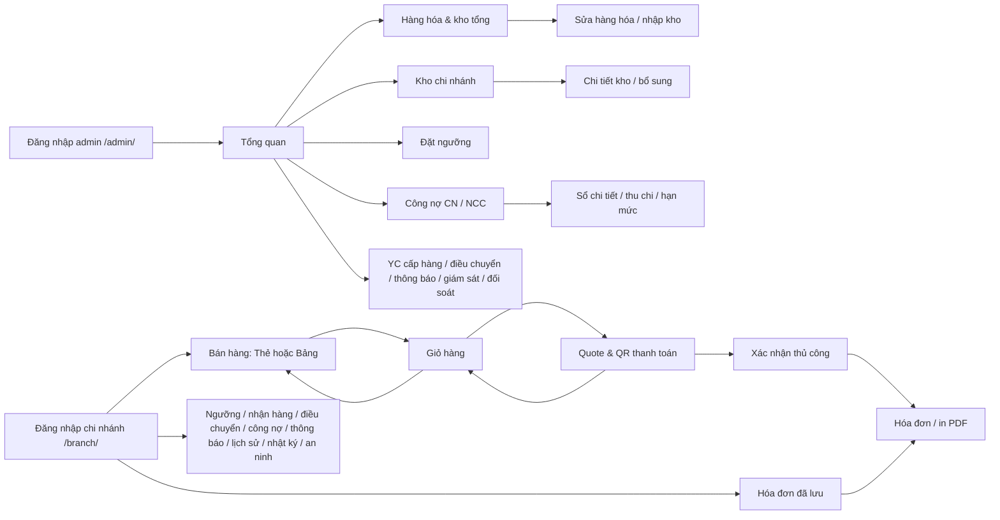

# Sơ đồ màn hình sau redesign

Route và xác thực giữ nguyên.

Sidebar desktop hoặc drawer chứa đúng chức năng theo role. Giỏ là action cạnh Tải lại tại bán hàng. Back đóng chi tiết hoặc form trước khi quay về module trước; bộ lọc tổng quan admin giữ ở parent như trước.
